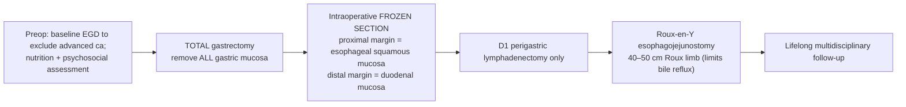
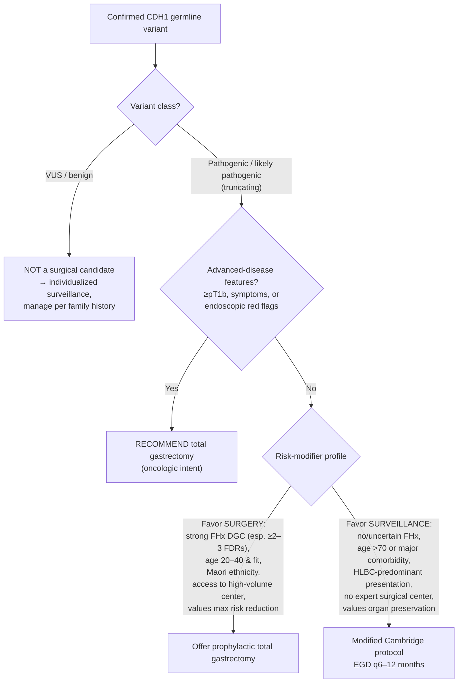

## Lecture at a glance

A single-slide framing of the syndrome, the two cancers it causes, and the two management arms this lecture develops.

```         
┌───────────────────────────────────────────────────────────────────────────┐
│         CDH1 GERMLINE PATHOGENIC/LIKELY PATHOGENIC VARIANT                   │
│         (Hereditary Diffuse Gastric & Lobular Breast Cancer Syndrome)        │
│         Encodes E-cadherin • ~1 in 5,000–8,000 • tumor suppressor           │
└───────────────────────────────┬───────────────────────────────────────────┘
                                 │
              ┌──────────────────┴───────────────────┐
              ▼                                        ▼
   ┌───────────────────────┐               ┌────────────────────────┐
   │  DIFFUSE GASTRIC CA    │               │  LOBULAR BREAST CA      │
   │  (signet-ring cell)    │               │  (E-cadherin loss is    │
   │  M ~10% / F ~7%        │               │   the defining feature) │
   │  ADVANCED risk to 80   │               │  Women ~37–55% to 80    │
   └───────────┬───────────┘               └───────────┬────────────┘
               │                                         │
      ┌────────┴─────────┐                     ┌─────────┴──────────┐
      ▼                  ▼                      ▼                    ▼
 SURVEILLANCE     PROPHYLACTIC             MRI + MAMMO          RISK-REDUCING
 (Cambridge       TOTAL GASTRECTOMY        SURVEILLANCE          MASTECTOMY
  protocol EGD)   (curative-intent         (from age 30)         (discuss/offer)
                  risk elimination)
```

**Learning objectives** 1. Explain E-cadherin biology and how biallelic *CDH1* inactivation initiates diffuse gastric cancer (DGC) and invasive lobular breast cancer (ILC). 2. Quote the *contemporary* penetrance estimates and the critical distinction between ubiquitous indolent pT1a signet-ring foci and clinically significant advanced cancer. 3. Perform/interpret guideline-concordant endoscopic surveillance (modified Cambridge protocol) and understand its limits. 4. State the indications, timing, technique, pathology, and outcomes of prophylactic total gastrectomy (PTG). 5. **Risk-stratify which carriers should be steered toward surgery vs. surveillance.**


## 

------------------------------------------------------------------------

## 1. The gene and the protein

*CDH1* sits on chromosome **16q22.1** and encodes **E-cadherin (epithelial cadherin)**, a calcium-dependent transmembrane glycoprotein at the basolateral membrane of epithelial cells; germline P/LP variants occur in roughly **1 in 5,000–8,000** people\[93\]\[94\]\[2\]. E-cadherin has three parts\[96\]:

- **Extracellular domain** — five cadherin repeats (EC1–EC5) that bind E-cadherin on the neighboring cell (homophilic *trans* "strand-swap" adhesion), rigidified by calcium\[96\]\[97\].
- **Single transmembrane domain.**
- **Cytoplasmic tail** — anchors the **catenin complex** to the actin cytoskeleton\[93\]\[94\].

The cadherin–catenin complex is the core of the **adherens junction**: **β-catenin** links the tail to **α-catenin** (an actin-coupled mechanosensor), **p120-catenin** binds the juxtamembrane domain and stabilizes surface E-cadherin against endocytosis, and **γ-catenin/plakoglobin** can substitute for β-catenin\[97\]\[98\]\[102\]\[101\]. Beyond mechanical adhesion, E-cadherin governs cell polarity, contact inhibition, Wnt/Rho/Hippo/PI3K signaling, EMT suppression, and — importantly for carcinogenesis — **mitotic spindle orientation**\[93\]\[95\]\[105\].

```         
        E-CADHERIN AT THE ADHERENS JUNCTION (two adjacent epithelial cells)

     Cell A                                          Cell B
   ══════════╗   EC1–EC5 (Ca²⁺-dependent trans-bind)  ╔══════════
   membrane  ║◄──────────  ▓▓▓▓▓ ══ ▓▓▓▓▓  ──────────►║ membrane
             ║  p120 ─┐                        ┌─ p120 ║
             ║        ├─ β-catenin ─ α-catenin ┤       ║
             ║        │       │                │       ║
             ║      ACTIN CYTOSKELETON ◄───────┘       ║
   ══════════╝                                         ╚══════════
   Loss of E-cadherin → junction collapse, loss of polarity,
   randomized spindle orientation, anoikis resistance, invasion.
```

------------------------------------------------------------------------

## 2. Two-hit carcinogenesis: how loss of adhesion becomes cancer

Neoplasia follows **Knudson's two-hit model**\[2\]\[113\]:

- **First hit (germline):** one inactivating *CDH1* allele in every cell. \~75% of pathogenic variants are truncating (nonsense/frameshift/splice), \~25% missense, \~4% large deletions\[114\]\[115\].
- **Second hit (somatic):** inactivation of the remaining wild-type allele → complete E-cadherin loss\[2\]\[117\]. In early intramucosal lesions the dominant second hit is **CDH1 promoter hypermethylation (\~50%)**, whereas **LOH predominates in metastases**; point mutations as a second hit are rare\[119\]\[121\]\[117\].

## Two-hit

```{mermaid}
flowchart TD
    A["Germline CDH1 variant<br/>(1st hit — all cells heterozygous)"] --> B["Somatic 2nd hit<br/>promoter methylation (early) / LOH (late)"]
    B --> C["Complete E-cadherin loss"]
    C --> D["Loss of adhesion + randomized<br/>mitotic spindle orientation"]
    D --> E["Cells deposited into lamina propria<br/>→ intramucosal pT1a signet-ring foci (indolent)"]
    E -->|"Additional hits:<br/>TP53, RhoA, c-Src, EMT"| F["Advanced diffuse gastric cancer<br/>(linitis plastica)"]
```

The mechanistic engine is spindle misorientation: E-cadherin recruits **LGN/NuMA/Gαi–dynein** to cell–cell contacts to keep the mitotic spindle parallel to the epithelial plane; when E-cadherin is lost, division orientation randomizes and daughter cells are displaced out of the epithelium into the lamina propria, seeding signet-ring foci\[122\]\[123\]\[124\]. Progression from indolent pT1a to **advanced** DGC requires *additional* molecular events (TP53, RhoA gain-of-function, c-Src)\[94\]\[127\].

------------------------------------------------------------------------

## 3. Histopathology — the finding you will see in nearly every specimen

- **88–97%** of prophylactic gastrectomy specimens contain occult **intramucosal (pT1a) signet-ring cell carcinoma (SRCC)** — often multifocal (from a few to several hundred foci), 0.1–10 mm, distributed cardia-to-pylorus\[40\]\[2\]\[160\].
- Two precursor patterns: **in situ SRCC** (signet-ring cells within an intact basement membrane, essentially pathognomonic for HDGC) and **pagetoid spread** beneath preserved epithelium\[160\]\[161\]\[162\].
- Early foci are **hypoproliferative (low Ki-67), lack nuclear β-catenin**, and are generally **indolent** — most never progress\[120\]\[127\].
- **≥pT1b disease is found in only 2–3%** of prophylactic specimens\[40\].
- **No correlation between patient age and number of foci** — foci burden does not predictably rise with age\[152\]\[166\].

The signet-ring morphology is a direct read-out of adhesion loss: discohesive cells cannot form glands and infiltrate singly, mucin displacing the nucleus. The same E-cadherin loss underlies the **single-file infiltrative pattern of invasive lobular breast cancer** and its anoikis resistance (cytosolic p120 → Rho/ROCK)\[110\]\[111\]\[132\].

<visual>Figure 1\[129\]</visual>

------------------------------------------------------------------------

## 4. Cancer risk — the numbers that drive management

Historical kindred-based estimates (67–83% lifetime gastric cancer risk) were inflated by ascertainment bias\[32\]\[30\]. Contemporary, less-selected cohorts — culminating in [@ryan722] (883 carriers, 213 families) — separate ubiquitous pT1a foci from clinically meaningful disease\[4\]\[35\].

Cancer endpoint

| Cancer endpoint \| Cumulative risk to age 80 \| Mean age at onset \| References \| \|---\|---\|---\|---\| \| **Advanced gastric ca (≥ stage II), males** \| **\~10.3%** \| 47–49 y \| \[4\]\[35\]\[2\] \| \| **Advanced gastric ca (≥ stage II), females** \| **\~6.5–7%** \| 47–49 y \| \[4\]\[35\]\[2\] \| \| Gastric ca including occult pT1a, males \| 37–42% \| — \| \[2\]\[33\]\[34\] \| \| Gastric ca including occult pT1a, females \| 25–33% \| — \| \[2\]\[33\]\[34\] \| \| **Lobular breast cancer (females)** \| **37–55%** \| 51–54 y (some series \~42 y) \| \[1\]\[2\]\[3\]\[8\] \|

**Family history is the single strongest modifier of gastric-cancer risk** — the key concept for deciding who needs surgery\[35\]\[37\].

<mdtable> \| Affected first-degree relatives with DGC \| Estimated gastric-cancer risk to age 80 \| References \| \|---\|---\|---\| \| Irrespective of family history \| \~7–10% \| \[4\]\[35\] \| \| None \| \~10% \| \[35\] \| \| 1 \| \~18% \| \[35\] \| \| 2 \| \~28% \| \[35\] \| \| 3 \| \~38% (95% CI 25–64%) \| \[35\]\[37\] \| </mdtable>

```         
   GASTRIC-CANCER RISK RISES STEEPLY WITH FAMILY BURDEN
   (advanced-cancer risk to age 80, Ryan et al. JAMA 2024)

   3 FDRs │██████████████████████████████████████  ~38%
   2 FDRs │████████████████████████████            ~28%
   1 FDR  │██████████████████                      ~18%
   0 FDR  │██████████                              ~10%
          └────────┴────────┴────────┴────────┴────────
          0%      10%      20%      30%      40%
```

By contrast, **lobular breast cancer risk (\~37%) is stable regardless of gastric-cancer family history**, and between ages 40–69 a woman's decade-specific breast-cancer risk exceeds her gastric-cancer risk\[3\]\[5\]\[6\]. **No reliable genotype–phenotype correlation exists**; all confirmed P/LP variants are truncating, and missense changes are generally classified VUS and are *not* an indication for surgery\[41\]\[42\]\[39\].

<visual>Figure 2\[29\]</visual>

------------------------------------------------------------------------

## 5. Who should be tested (NCCN / IGCLC 2020)

Test criteria have progressively broadened. The **IGCLC 2020** family/individual criteria capture \~84% of carriers but had only \~24% sensitivity in an unselected P/LP cohort; the broader **NCCN/Yale criteria reached \~82%** because most modern carriers surface on multigene breast panels rather than classic HDGC pedigrees\[51\]\[53\]\[57\]\[58\].

**IGCLC 2020 — any one of\[53\]\[54\]\[55\]:** - ≥2 gastric cancers in the family (any age), ≥1 confirmed DGC - ≥1 DGC (any age) **and** ≥1 lobular breast cancer \< 70 y in different relatives - ≥2 lobular breast cancers \< 50 y - DGC \< 50 y - DGC at any age in individuals of **Māori** ethnicity - DGC at any age with personal/family history of **cleft lip/palate** - DGC **and** LBC in one person, both \< 70 y - Bilateral LBC \< 70 y - Gastric in situ signet-ring cells / pagetoid spread \< 50 y

Test **CTNNA1** if *CDH1*-negative\[55\]. All DGC/LBC diagnoses must be histologically confirmed\[53\].

------------------------------------------------------------------------

## 6. Endoscopic surveillance — the modified Cambridge protocol

**Setting & cadence.** Perform at centers experienced with HDGC, flag *CDH1* status on the requisition, and scope at **6–12 month** intervals (every 6 months if a prior positive biopsy or if the patient meets surgical criteria but declines)\[60\]\[61\]. GeneReviews suggests starting at **age 40** (or 5–10 years before the youngest family cancer; minimum age 18)\[61\].

**Technique** (each element matters)\[60\]\[61\]\[63\]: 1. ≥30-minute high-definition **white-light** inspection of the entire stomach. 2. **Clear all mucus/debris** (simethicone / N-acetylcysteine lavage). 3. **Full insufflation** and assessment of **distensibility** (to detect linitis plastica). 4. **Narrow-band imaging** across all regions. 5. **Targeted** cold-forceps biopsies of any **pale area**, erosion, ulcer, nodule, or rigid fold; pale areas carry a high NPV (0.975) but low PPV (\~0.12) for SRCC\[71\]. 6. **Random mapping biopsies** — modified Cambridge distribution (24 biopsies):

```         
        MODIFIED CAMBRIDGE RANDOM-BIOPSY MAP (24 total)  — NCCN-endorsed
        (plus targeted biopsies of every visible abnormality)

                    ╔═══════════════╗
                    ║   CARDIA  ×4  ║      ← proximal / GE junction
                    ╠═══════════════╣
             FUNDUS ×4               (proximal stomach: high SRCC yield)
                    ╠═══════════════╣
                    ║  BODY/CORPUS  ║
                    ║      ×6       ║
                    ╠═══════════════╣
                    ║ TRANSITION ×4 ║      ← body–antrum transition zone
                    ╠═══════════════╣
                    ║   ANTRUM  ×4  ║
                    ╠═══════════════╣
                    ║ PREPYLORIC ×2 ║      → toward pylorus / duodenum
                    ╚═══════════════╝
        Original Cambridge = 30 (5 each × 6 regions);
        IGCLC 2020 = 28–30; Bethesda (research only) = 88 biopsies.
```

**Interpretation & limits.** NCCN states explicitly that **the goal is NOT to find pT1a foci** (nearly universal and indolent) but to detect features of **\>pT1a** disease\[60\]. Random-biopsy sensitivity is poor: the Cambridge method detects occult SRCC in only \~15–63% while gastrectomy shows 88–97% (false-negative rate \~80%); the research **Bethesda 88-biopsy** protocol raises per-endoscopy detection to \~36% but is not recommended for routine care\[80\]\[40\]\[67\]. EUS, autofluorescence, and confocal endomicroscopy add little; chromoendoscopy may improve yield (OR \~20 vs. white light in one series)\[78\]\[67\]\[74\]. Reassuringly, across the largest surveillance cohorts (NIH 270 patients/5 y; Cambridge 145 patients/16 y; French and MGH series) **no gastric-cancer deaths** were reported and progression beyond pT1a was rare — but follow-up is short and crossover to surgery is common\[49\]\[89\]\[91\]\[92\]\[40\].

------------------------------------------------------------------------

## 7. Prophylactic (risk-reducing) total gastrectomy

### 7.1 Indications

Per **NCCN v1.2026 / IGCLC 2020**, gastrectomy is **recommended** when any of the following are present\[48\]: - Established **≥pT1b** SRCC. - Persistent unexplained symptoms attributable to advanced disease (weight loss, early satiety, anemia, pain). - Endoscopic signs of advanced disease — poor distensibility/linitis plastica, ulceration, thickened rigid folds, disturbed vascular pattern.

For carriers **without** these features, current guidance frames the choice as **shared decision-making between PTG and surveillance** rather than mandatory surgery — a notable shift\[48\]. Detection of isolated pT1a SRCC on biopsy is **not**, by itself, a formal indication for gastrectomy (it is nearly universal), though it often informs patient choice\[60\]\[91\]. Uptake of PTG has fallen from **83% (2001–2010) to \~68% (2021–2025)**\[50\].

### 7.2 Timing

- Generally **ages 20–30**, individualized by personal/family history and preference; Markov modeling supports this window for quality-adjusted life-years\[48\]\[144\]\[148\].
- **Not routine after \~70 years** (rising perioperative risk, diminishing benefit) and **not before physical maturity** in adolescents; overtreatment is a real concern in adolescents/young adults\[144\]\[146\]\[147\].
- No emergency: even a positive pT1a biopsy does not warrant a rushed operation\[145\].

### 7.3 Technique — the surgical imperatives



- **Complete resection is the cardinal rule.** Retained proximal (cardia) or distal gastric mucosa is a documented failure mode requiring re-resection/reoperation — hence **mandatory frozen-section confirmation** of both margins\[30\]\[144\]\[150\].
- **D1 (perigastric) lymphadenectomy is sufficient**; nodal metastases are essentially absent in T1a/in situ disease, so extended dissection only adds morbidity\[144\]\[145\]\[151\]\[152\].
- **Minimally invasive (laparoscopic/robotic)** approaches improve short-term recovery, but **surgeon/center experience matters more than the approach** — operate at high-volume HDGC centers\[144\]\[154\].

### 7.4 Pathology yield

Occult pT1a SRCC is found in **88–97%** of specimens (96% in the Stillman series; 88% in the NIH 150-patient series), while **advanced (\>pT1a) cancer appears in only \~1–3%**\[152\]\[156\]\[40\]\[50\].

### 7.5 Outcomes

<mdtable> \| Domain \| Typical result \| References \| \|---\|---\|---\| \| Perioperative mortality \| \<1% at expert centers \| \[144\]\[157\] \| \| Major morbidity (Clavien-Dindo ≥3) \| \~6–19%; anastomotic leak \~4–7% \| \[81\]\[156\] \| \| Anastomotic stricture \| \~5% ≤30 d; \~15% at 1–3 mo \| \[144\]\[168\] \| \| Weight loss \| peaks \~15–20% at 3–6 mo, then stabilizes \| \[144\]\[167\]\[168\] \| \| Chronic GI sequelae at 2 y \| \~94% have ≥1 (dumping, bile reflux, diarrhea) \| \[159\] \| \| Quality of life \| dips at 1 mo, \~baseline by 6–12 mo; symptoms persist \| \[159\]\[177\]\[179\] \| \| Decisional regret \| usually low, but up to \~43% in some series (worse if no SRCC found / complications) \| \[167\]\[178\]\[180\] \| \| Cancer recurrence / gastric-cancer death (early-stage) \| none reported \| \[155\]\[156\]\[157\] \| </mdtable>

**Mandatory lifelong nutrition surveillance**: vitamin **B12** (loss of intrinsic factor — supplement universally), **iron**, **calcium/vitamin D** (bone-density testing \~3 y post-op), fat-soluble vitamins, zinc/copper/selenium; use chewable/liquid drug formulations and non-oral contraception\[168\]\[171\]\[173\]\[172\].

<visual>Figure 2\[166\]</visual>

------------------------------------------------------------------------

## 8. WHO should have surgery? Risk-adapted selection (core teaching point)

The decision integrates **variant pathogenicity, family history, age/fitness, center expertise, and patient values** — surgery removes \~99% of gastric-cancer risk but imposes 100% lifelong physiologic cost, whereas surveillance preserves the stomach but has an \~80% per-exam false-negative rate\[40\]\[81\]\[183\]\[184\].



<mdtable> \| Factor \| Favors prophylactic gastrectomy \| Favors endoscopic surveillance \| References \| \|---\|---\|---\|---\| \| Variant \| Pathogenic/likely pathogenic (truncating) \| VUS or missense without supporting FHx (not a surgical candidate) \| \[45\]\[41\]\[42\] \| \| Family history of DGC \| Present, especially ≥2–3 affected FDRs (risk up to \~38%) \| Absent/uncertain (advanced-cancer risk \~10%) \| \[35\]\[37\]\[48\] \| \| Age & fitness \| \~20–40 y, good performance status \| \>70 y or significant comorbidity \| \[144\]\[146\] \| \| Endoscopic/clinical findings \| ≥pT1b, symptoms, linitis/ulcer/rigid folds \| Normal, distensible stomach; reassuring exams \| \[48\]\[151\] \| \| Center \| Access to high-volume HDGC surgical team \| No local expertise (favor referral or surveillance) \| \[144\]\[183\] \| \| Ethnicity \| Māori (historically higher penetrance) \| — \| \[183\]\[184\] \| \| Phenotype emphasis \| Gastric-predominant kindred \| HLBC-predominant, minimal DGC history \| \[183\]\[184\] \| \| Patient values \| Prioritizes maximal cancer risk reduction \| Prioritizes organ preservation / QoL \| \[48\] \| </mdtable>

<visual_group>Figure 1\[183\], Figure 2\[184\]</visual_group>

**Bottom line for selection:** A young, fit carrier of a *truncating* variant from a DGC-dense family, cared for at an expert center, is the prototypical candidate for **PTG**. An older carrier, a carrier with a VUS, or one with no family history of gastric cancer — particularly when the kindred is breast-predominant — is reasonably managed with **expert surveillance**, with surgery reserved for advanced-disease features\[48\]\[183\]\[184\].

------------------------------------------------------------------------

## 9. Breast cancer: don't forget the second organ

Every **female** carrier needs a parallel breast program, because ILC risk (\~37–55%) is high, presents young, and is poorly seen on mammography (sensitivity as low as \~34%; MRI \~88%)\[1\]\[2\]\[17\]\[9\].

<mdtable> \| Element \| NCCN \| IGCLC 2020 \| References \| \|---\|---\|---\|---\| \| Breast MRI (± contrast) \| Annual from **age 30** \| Annual from **age 30** \| \[1\]\[12\] \| \| Mammography \| Annual from age 30 (with MRI) \| Supplemental from \~35–40 \| \[1\]\[12\] \| \| Clinical breast exam \| Every 6–12 mo from age 25 \| Annual from age 30 \| \[10\]\[12\] \| \| Risk-reducing mastectomy \| **Discuss/offer** (high-penetrance gene) \| Consider bilateral RRM ± reconstruction \| \[1\]\[10\]\[12\]\[13\] \| \| Chemoprevention \| May consider (SERM/AI; ILC is ER+) \| May reduce risk \~50% \| \[10\]\[12\] \| \| If MRI unavailable \| Contrast-enhanced mammography or MBI; then US \| US + annual mammography \| \[11\]\[12\] \| </mdtable>

About one-third of female carriers elect risk-reducing mastectomy, most with a positive breast family history; nipple-sparing mastectomy is considered safe, and completeness of resection drives risk reduction\[24\]\[25\]\[23\]. Screening recommendations are largely **extrapolated from BRCA data** — no randomized trial compares MRI screening to RRM in *CDH1* carriers\[10\]\[15\].

<visual>GENE-A-7\[1\]</visual>

------------------------------------------------------------------------

## 10. Take-home messages for the surgical resident

1.  *CDH1* → E-cadherin; **two-hit** biallelic loss (germline + methylation/LOH) initiates DGC and ILC\[2\]\[117\]\[119\].
2.  **Nearly every carrier harbors occult pT1a signet-ring foci (88–97%), but most never progress**; advanced-cancer prevalence at PTG is only 2–3%\[40\]\[160\].
3.  **Contemporary advanced-cancer risk is \~10% (M) / \~7% (F)** to age 80 — far below historical figures — and scales with **family history** (up to \~38% with 3 affected FDRs)\[4\]\[35\]\[37\].
4.  Surveillance = **modified Cambridge protocol** with mucosal cleaning, distensibility check, NBI, targeted + 24 random biopsies; its goal is to catch **\>pT1a** disease, not to hunt pT1a foci\[60\].
5.  PTG technical imperatives: **complete resection with frozen-section margins, D1 nodes only, Roux-en-Y with a 40–50 cm limb**; \<1% mortality but 100% lifelong nutritional/GI consequences\[144\]\[150\]\[157\].
6.  **Select for surgery by risk profile:** truncating variant + strong DGC family history + young/fit + expert center → PTG; VUS, no family history, elderly/comorbid, or breast-predominant kindred → surveillance and referral\[48\]\[183\]\[184\].
7.  **Manage the breast in parallel** — MRI from age 30, discuss risk-reducing mastectomy\[1\]\[12\].
8.  Care belongs in a **multidisciplinary, high-volume HDGC program** (surgery, genetics, GI, pathology, dietetics, psychology)\[144\]\[168\].

------------------------------------------------------------------------

*Prepared as a teaching resource from current NCCN (v1.2026), IGCLC 2020, and primary literature. Figures referenced in the accompanying answer illustrate carcinogenesis (Gamble et al., JAMA Surg 2021), penetrance (Ryan et al., JAMA 2024), gastrectomy outcomes (Stillman et al., 2022), and the surgery-vs-surveillance decision (Corso et al., 2024).*

1.
CDH1 c.220C>T.
OncoKB. 2026. Memorial Sloan KetteringGenomics
2.
E‐Cadherin and Gastric Cancer: Cause, Consequence, and Applications.
BioMed Research International. 2014. Liu X, Chu KM.Review
3.
Structure and Biochemistry of Cadherins and Catenins.
Cold Spring Harbor Perspectives in Biology. 2009. Shapiro L, Weis WI.Review
4.
Current Advances in Understanding the Molecular Profile of Hereditary Diffuse Gastric Cancer and Its Clinical Implications.
Journal of Experimental & Clinical Cancer Research : CR. 2023. Lim HJ, Zhuang L, Fitzgerald RC.Review
5.
Familial Gastric Cancer: Genetic Susceptibility, Pathology, and Implications for Management.
The Lancet. Oncology. 2015. Oliveira C, Pinheiro H, Figueiredo J, Seruca R, Carneiro F.Review


6.
Quantification of Epigenetic and Genetic 2nd Hits in CDH1 During Hereditary Diffuse Gastric Cancer Syndrome Progression.
Gastroenterology. 2009. Oliveira C, Sousa S, Pinheiro H, et al.
7.
Cell Division-Dependent Dissemination Following E-Cadherin Loss Underlies Initiation of Diffuse-Type Gastric Cancer.
The Journal of Pathology. 2024. Monster JL, Kemp LJ, Busslinger GA, et al.
8.
Hereditary Diffuse Gastric Cancer.
Gastroenterology. 2023. Decourtye-Espiard L, Guilford P.Review
9.
Hereditary Diffuse Gastric Cancer Syndrome and the Role of CDH1: A Review.
JAMA Surgery. 2021. Gamble LA, Heller T, Davis JL.Review


10.
Cytosolic P120-Catenin Regulates Growth of Metastatic Lobular Carcinoma Through Rock1-Mediated Anoikis Resistance.
The Journal of Clinical Investigation. 2011. Schackmann RC, van Amersfoort M, Haarhuis JH, et al.
11.
E-Cadherin-Mediated Cell-Cell Adhesion and Invasive Lobular Breast Cancer.
Advances in Experimental Medicine and Biology. 2025. Bullock E, Brunton VG.Review
12.
Genetic/Familial High-Risk Assessment: Colorectal, Endometrial, Esophageal, and Gastric.
National Comprehensive Cancer Network. Updated 2026-06-16.Guideline
13.
Germline CDH1 Variants and Lifetime Cancer Risk.
The Journal of the American Medical Association. 2024. Ryan CE, Fasaye GA, Gallanis AF, et al.Observational


14.
Bilateral Prophylactic and Contralateral Risk‐Reducing Mastectomy in Women With Germline CDH1 Pathogenic or Likely‐Pathogenic Variants.
Journal of Surgical Oncology. 2026. Corso G, Vecchia C, Magnoni F, et al.Review
15.
Enhanced Endoscopic Detection of Occult Gastric Cancer in Carriers of Pathogenic CDH1 Variants.
Journal of Gastroenterology. 2021. Curtin BF, Gamble LA, Schueler SA, et al.
16.
Outcomes After Prophylactic Gastrectomy for Hereditary Diffuse Gastric Cancer.
The British Journal of Surgery. 2018. van der Kaaij RT, van Kessel JP, van Dieren JM, et al.
17.
Total Gastrectomy for Hereditary Diffuse Gastric Cancer at a Single Center: Postsurgical Outcomes in 41 Patients.
Annals of Surgery. 2017. Strong VE, Gholami S, Shah MA, et al.
18.
Costs of Cancer Prevention: Physical and Psychosocial Sequelae of Risk-Reducing Total Gastrectomy.
Journal of Clinical Oncology : Official Journal of the American Society of Clinical Oncology. 2024. Gallanis AF, Gamble LA, Samaranayake SG, et al.
19.
Short and long‐term outcomes of prophylactic total gastrectomy in 54 consecutive individuals with germline pathogenic mutations in the CDH1 gene.
Journal of Surgical Oncology. 2022. Stillman MD, Kusche N, Toledano S, et al.
20.
Pleiotropic cancer manifestations of germline CDH1 mutations: Risks and management.
Journal of Surgical Oncology. 2022. Corso G.Review
21.
Points to consider regarding prophylactic total gastrectomy in germline CDH1 variant carriers.
Journal of Surgical Oncology. 2024. Corso G, Davis JL, Strong VE.Review
22.
Genetic/Familial High-Risk Assessment: Breast, Ovarian, Pancreatic, and Prostate.
National Comprehensive Cancer Network. Updated 2026-08-31.Guideline
